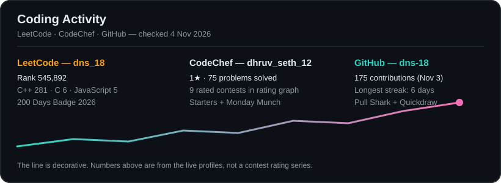

<h1 align="center">Hi 👋, I'm Dhruv</h1>

<h3 align="center">
  Frontend Developer • React Developer • Problem Solver
</h3>

  
  
  
  
  

  

---

## About Me

I'm a Computer Science student specialising in Data Science, focused on frontend development with React. I build real, deployed web applications — not just demos — and I care about both clean code and clean UI.

- Building reusable React UI components, and learning backend development step by step (Express + HTTP milestones)
- Practising Data Structures and Algorithms on LeetCode and CodeChef
- Working on open-source contributions in JavaScript / TypeScript
- Open to collaborating on interesting projects

Ask me about **React, JavaScript, frontend development, and UI**.

---

## Featured Projects

<table>
<tr>
<td width="50%">

### AppScribe

A full-stack writing / blogging platform with authentication, role-based access, database functionality, and file storage.

**Tech:** React · Appwrite · Redux Toolkit · Tailwind CSS

[View Repository](https://github.com/dns-18/AppScribe) · [View Live](https://app-scribe-dns.vercel.app/)

</td>
<td width="50%">

### ResumeIQ

AI resume analysis and career copilot, with real Supabase login / signup and a redesigned post-login app.

**Tech:** React · Vite · Supabase · Tailwind CSS

[View Repository](https://github.com/dns-18/ResumeIQ) · [View Live](https://resume-iq-dns.vercel.app/)

</td>
</tr>
<tr>
<td width="50%">

### My Portfolio

My personal developer portfolio, showcasing projects, skills, and frontend work.

**Tech:** HTML · CSS · JavaScript · GSAP

[View Repository](https://github.com/dns-18/My-Portfolio) · [View Live](https://my-portfolio-dns-18.vercel.app/)

</td>
<td width="50%">

### ShopSphere

A responsive e-commerce application with product browsing, search, categories, product details, and cart functionality.

**Tech:** React · JavaScript · API · CSS

[View Repository](https://github.com/dns-18/shopsphere-ecommerce)

</td>
</tr>
<tr>
<td width="50%">

### StayLuxe

A modern accommodation / booking-focused web application with a responsive user interface.

**Tech:** React · Vite · Tailwind CSS

[View Repository](https://github.com/dns-18/StayLuxe)

</td>
<td width="50%">

### VarshaNetra

AI / ML-based early-warning and rainfall / flood-risk prediction prototype for Smart India Hackathon 2026.

**Tech:** TypeScript · Python · AI / ML

[View Repository](https://github.com/dns-18/VarshaNetra)

</td>
</tr>
</table>

[View all repositories](https://github.com/dns-18?tab=repositories)

---

## Technical Skills

Badges below show technologies used in my projects and coursework. They are not proficiency levels.

**Frontend Development**

  

**UI Development**

- shadcn/ui — used in the ResumeIQ post-login redesign
- Responsive, component-based UI development — used across AppScribe, ResumeIQ, ShopSphere, and StayLuxe

**Backend & Database**

  

**Programming & CS Fundamentals**

  

- Data Structures and Algorithms · Object-Oriented Programming · DBMS · Operating Systems

**Developer Tools**

- Git · GitHub · VS Code · Vercel

---

## Problem Solving & Achievements

  
  
  

- **LeetCode (`dns_18`):** Rank 545,892 (checked 4 Nov 2026), C++ 281 · C 6 · JavaScript 5 problems by language, 200 Days Badge 2026. No total solved number is shown here, because the live profile total could not be verified from the profile page alone — see the live LeetCard below for the current count.
- **CodeChef (`dhruv_seth_12`):** 1 star, 75 problems solved, 9 rated contests in the rating graph.
- **GitHub achievements visible:** Pull Shark, Quickdraw.
- **Open source:** DevFlow PR merged by its maintainer; devFind SEO metadata PR #1288 open, awaiting maintainer review; CHT Core PR #11467 open, awaiting linking to its issue.

  

  
  

> The custom card above is a static snapshot checked 4 Nov 2026. The LeetCard images below it are live and update automatically. If a live card ever renders broken, the static card above still shows.

---

## GitHub Statistics

| | |
|---|---|
| Total contributions | **175** (Apr 10, 2024 – present, checked Nov 3) |
| Current streak | **0 days** (Nov 3) |
| Longest streak | **6 days** (Oct 7 – Oct 12, 2025) |
| Achievements visible | **Pull Shark, Quickdraw** |
| Focus | **React, TypeScript, JavaScript, Tailwind CSS** |

  

See the full, always-up-to-date graph on my [GitHub profile](https://github.com/dns-18) — it is GitHub's own contribution graph, so it never depends on a third-party image service.

> Note: the old activity-graph, trophy, and github-readme-stats images were removed previously because their public Vercel deployments returned HTTP 402 / 503. They are not re-added here, to avoid reintroducing broken images. The text table above and the streak card are kept instead.

---

## Contribution Snake

<picture>
  <source media="(prefers-color-scheme: dark)" srcset="https://raw.githubusercontent.com/dns-18/dns-18/output/github-snake-dark.svg" />
  <source media="(prefers-color-scheme: light)" srcset="https://raw.githubusercontent.com/dns-18/dns-18/output/github-snake.svg" />
  
</picture>

Generated automatically every 6 hours by the snake workflow (`.github/workflows/snake.yml`, `output` branch). Both light and dark variants are generated by that workflow; this section only changes how they are displayed, not the workflow itself.

---

## Currently Learning

- Backend development — Node.js / Express, HTTP fundamentals, step by step
- Java
- Modern React development — reusable components, state management with Redux Toolkit
- Open-source contribution workflow — issues, branches, PRs, and maintainer review

---

## Connect With Me

  
  
  
  
  
  

---

  <i>Always building something new.</i>

  

